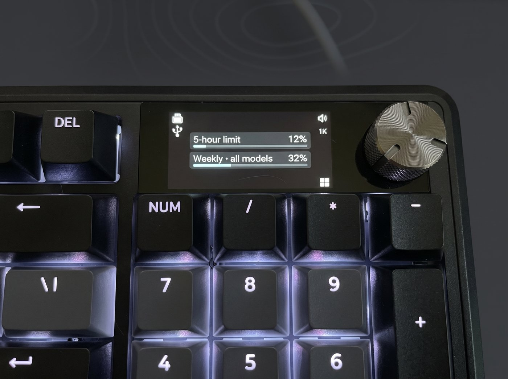
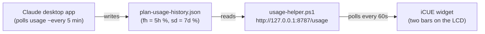

# Claude Usage on a Corsair Vanguard 96 LCD

Show your Claude subscription usage — the **5‑hour** and **7‑day** limits — on the
320×170 LCD of a Corsair Vanguard 96 / Vanguard Pro 96 keyboard, as a custom
iCUE widget.



## How it works

The widget's webview can't read your Claude token or call Anthropic directly, and
the token isn't stored in plaintext anyway. Instead, a tiny **local helper**
reads the usage numbers the **Claude desktop app already caches on disk**, and
serves them as JSON on localhost. The widget just polls that and draws two bars.



**No token is ever read, stored, or logged.** The helper only reads a local
cache file and binds to `127.0.0.1` only. It serves just the two usage
percentages and their freshness, with no account IDs or file paths, so nothing
identifying is exposed to other software on the machine.

## Requirements

- Windows, with the **Claude desktop app** installed and signed in (it produces
  the usage cache this reads).
- **iCUE 5.44+** and a **Vanguard 96 / Vanguard Pro 96** keyboard.
- The **iCUE Widget CLI** (`icuewidget`) — only needed to build the widget
  yourself. Download it from the *More Downloads* section of
  <https://www.corsair.com/downloads>.
- No runtime to install — the helper is Windows PowerShell.

## Setup

**1. Run the helper at login (hidden, no window):**

```powershell
powershell -NoProfile -ExecutionPolicy Bypass -File .\helper\install-at-login.ps1
```

Start it immediately without logging out:

```powershell
wscript ".\helper\run-helper-hidden.vbs"
```

Verify: open <http://127.0.0.1:8787/usage> — you should see your percentages.

**2. Build & import the widget:**

```powershell
icuewidget validate widget\ClaudeUsage
icuewidget package  widget\ClaudeUsage
```

Then in iCUE: **Widgets → ＋ →** import the resulting `claude-usage.icuewidget`,
and add **Claude Usage** to the keyboard LCD.

## Behavior

- **Colors:** neutral under 60%, amber 60–85%, red above 85%.
- **Update cadence:** the widget polls every 60s and the helper caches for 60s,
  but the numbers only actually change about **every ~5 minutes** — that's how
  often the desktop app refreshes its cache. Polling faster won't help.
- **Stale/offline:** if the helper is unreachable or the desktop app isn't
  running (so the cache goes stale > 11 min), the panel **dims** instead of
  blanking, keeping the last known values.

## Configuration

Knobs at the top of [`helper/usage-helper.ps1`](helper/usage-helper.ps1):
`$Port`, `$CacheTtlSeconds`, `$StaleAfterSeconds`. The widget's poll interval and
color thresholds are in [`widget/ClaudeUsage/index.html`](widget/ClaudeUsage/index.html).

Everything that knows the **shape of the usage cache file** lives in one place —
the `Read-UsageSource` function in `usage-helper.ps1`. If Anthropic changes that
file, fix it there and nowhere else.

## Repository layout

```
helper/     the local service (PowerShell) + login launcher
widget/     the iCUE keyboard_lcd widget source
docs/       README images
spike/      throwaway Phase-0 connectivity test (proves the LCD webview can
            fetch http://127.0.0.1) — safe to delete
```

## Notes & disclaimer

- The usage data comes from an **undocumented, unofficial** local cache written
  by the Claude desktop app; it can change or disappear at any time.
- Reset-time text ("Resets in 3 hr 50 min") is intentionally **not shown** — the
  local cache stores only the percentages, not reset timestamps.
- Not affiliated with or endorsed by Anthropic or Corsair. Use at your own risk.
